# LanBridge illustrated user guide

**English** · [简体中文](USER_GUIDE.zh-CN.md) · [Back to README](../README.md)

This guide is for operating the packaged desktop app. No terminal, Python setup
or website is required for a normal transfer. Button names below match the
current English interface exactly.

**Recommended first run:** install both apps → pair → send a small file with
**Choose files…** → verify it arrived → then add Explorer/Finder integration.

| Jump to | What it explains |
| --- | --- |
| [Preparation](#preparation) | Which package to install and which computer does what |
| [Main window](#main-window) | Every main-window control |
| [Pairing](#pairing) | Allow pairing, Pair device, Codes match |
| [Send files](#send-files) | Single/multiple selection and recipient choice |
| [Receive files](#receive-files) | Accept, Decline and request timeout |
| [Progress / cancel](#progress-and-cancel) | Speed, remaining bytes, history and cancellation |
| [Saved files](#saved-files) | Receive folder, collisions and incomplete files |
| [Settings](#settings) | Name, folder, trust, startup and integration buttons |
| [Explorer / Finder](#file-manager) | Install, use and remove native actions |
| [Background operation](#background) | Close versus Quit; tray/menu-bar actions |
| [Manual connection](#manual-connection) | Two fallback modes and the correct ports |
| [Troubleshooting](#troubleshooting) | Symptoms, causes and next actions |
| [Security / limits](#security-and-limits) | What the preview supports and what remains unverified |

The images show actual Windows widgets from two isolated local demo instances.
The pairing and accepted transfer used real sockets and certificates. All three
received demo files matched their source SHA-256 digests. Transfer pacing was
slowed for a readable screenshot; pictured speed is not a benchmark. The example
device names, verification code, fingerprints, addresses and folders are not values
you should copy. Additional Mac images below are real M3 captures from [M7 physical testing](M7_ACCEPTANCE.md); see that record for the completed checks and remaining release gates.

## 1. Prepare both computers

1. Get the packages as described in [Download and install](../README.md#download-and-install).
   A GitHub artifact download is an outer ZIP containing the actual app package.
2. **Windows:** extract the portable ZIP completely and open `LanBridge/LanBridge.exe`.
   Moving only the exe without `_internal` breaks the package.
3. **Mac:** open the arm64 DMG, copy the app to Applications and run the copied app.
   Put it in its permanent location before installing the Finder action.
4. Keep both computers on a reachable LAN and both apps running. Guest networks,
   VPN routing or client isolation may prevent peer access, even on the same Wi-Fi name.
5. Optionally use **Settings… → Device name** to assign recognizable, different names.
   After saving a new name, **Quit** and restart to update the advertised name.

The **sender** is the computer with the original files. The **receiver** is the
computer that should save copies. Either Windows or Mac can take either role.

To test the reverse direction, swap roles. Start with a small harmless text file;
then try multiple files, a Unicode name, an empty file, and a larger file.

## 2. Find your way around the main window

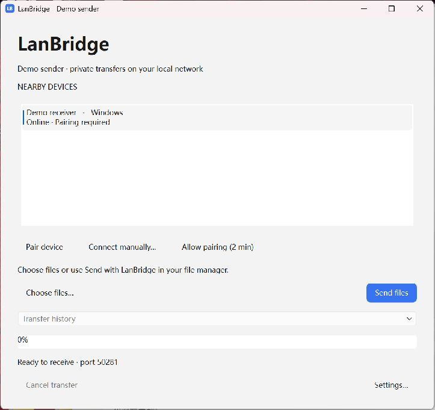

| Where / label | What to do | What it means |
| --- | --- | --- |
| Top subtitle | Read the local device name | This is the computer you are operating. |
| **NEARBY DEVICES** list | Click the intended recipient row | Rows show a name, platform and discovery/trust status. |
| **Pairing required** | Complete first pairing | The device has been seen but is not trusted. |
| **Paired** | Select it to send | Its certificate identity is saved; files still require Accept. |
| **Pair device** | Use on the sender after selecting an unpaired device | Starts first pairing. |
| **Allow pairing (2 min)** | Use on the recipient before pairing | Temporarily allows new pairing requests. It is not file auto-accept. |
| **Connect manually…** | Use only if normal discovery is unavailable | Offers manual pairing or an already-paired connection. |
| **Choose files…** | Open the OS picker | Replaces the current file selection when you choose new files. |
| **Remove selected / Clear list** | Edit the selected file list before sending | Removes entries from the next send and keeps original files. |
| **Send files** | Click after choosing files and a paired recipient | Starts a request; no file content is sent before acceptance. |
| **Transfer history** | Select a task | Chooses which task the progress area and Cancel button refer to. |
| Progress bar / status | Watch bytes, speed, remaining size and state | A complete receipt matters more than a 100% bar. |
| **Archive task** | Use after complete, failed, cancelled or declined | Closes the result and returns to Ready; the Archived entry remains in this session's Transfer history. |
| **Cancel transfer** | Cancel the task currently selected in the dropdown | Available while that task is active. |
| **Settings…** | Open settings | Configure name, destination, trusted devices and optional integrations. |

**Online is discovery information**, not a guarantee that a later TCP connection
will work. A machine can disconnect after advertising. LanBridge should report
the resulting error rather than claim success.

## 3. Pair the computers for the first time

### On the receiving computer

1. Open its LanBridge window, including from the tray/menu bar if hidden.
2. Click **Allow pairing (2 min)**. This opens a two-minute pairing window.

### On the sending computer

3. Click the receiver in **NEARBY DEVICES**.
4. Click **Pair device**. A **Verify device pairing** dialog appears on both sides.

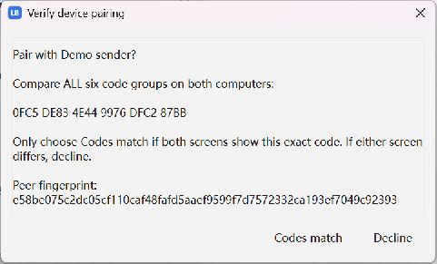

### On both computers

5. Compare **all six groups of the displayed code** against the other screen.
6. If every group matches, click **Codes match on both**. Clicking on only one
   computer is not sufficient.
7. If the code differs or the other computer is not the one you intended, click
   **Decline**. Do not approve solely because the device name looks familiar.
8. Confirm the device list shows **Paired**. Pairing trust survives restarting the app.

Pairing confirmation has a 120-second deadline. If it expires, or the final
confirmation was interrupted, enable pairing again and repeat with the new code.
There is no fixed PIN to type, and the code in this guide cannot be reused.

**Do you need Allow pairing every time you send?** No. It is for establishing
trust. Subsequent file requests still show their own Accept/Decline dialog.

## 4. Select files and send

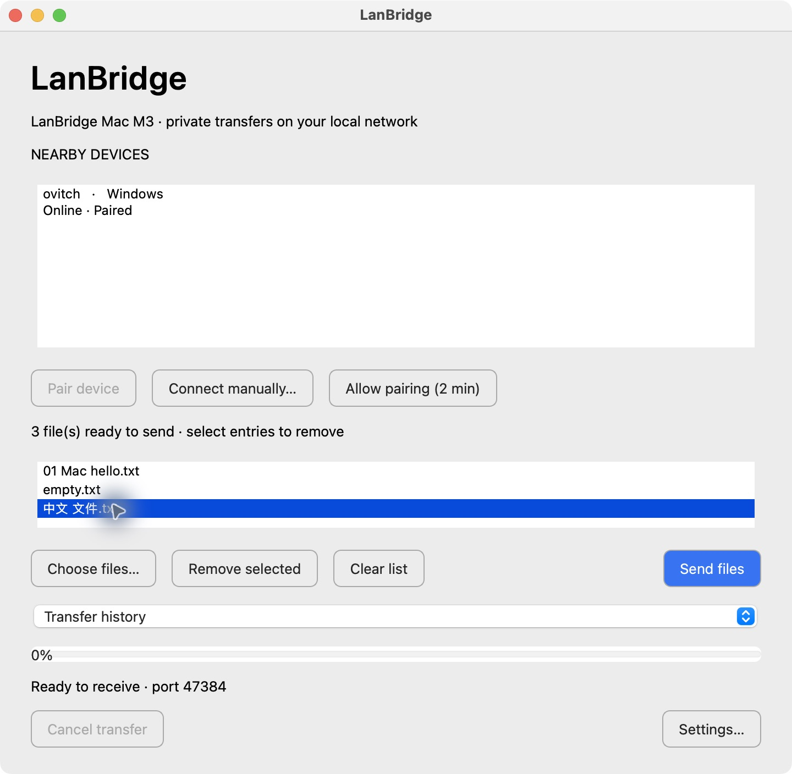

On the **sender**:

1. Click **Choose files…** below the device list.
2. In the OS picker, select files. Use Ctrl on Windows or Command on Mac for
   separate selections, or Shift for a range, then use the picker's Open action.
3. Review the scrollable file list in LanBridge. Hover over a name to see its full path.
4. Click the correct **Paired** recipient in **NEARBY DEVICES**.
5. Click the blue **Send files** button on the right.
6. Wait for the receiver's decision. Do not treat choosing files as sending them.

To remove mistakes before sending, select entries in the file list (Ctrl on
Windows, Command on Mac, or Shift for a range) and click **Remove selected**.
Delete/Backspace also removes entries when the list has keyboard focus.
**Clear list** removes all pending selections. Original files stay on disk.
These edits affect the next send; use **Cancel transfer** to stop an existing task.
**Choose files…** replaces the selection; cancelling its picker keeps the previous list.

If **Send files** cannot be used, check all three prerequisites: selected files,
a selected recipient, and **Paired** status. A blue background alone does not
prove that all prerequisites have been met.

Folders are not supported. If you want to send a folder's contents together,
create a ZIP with your OS first and send that ordinary file. LanBridge does not
automatically compress, extract or open the received ZIP.

## 5. Accept or decline on the receiver

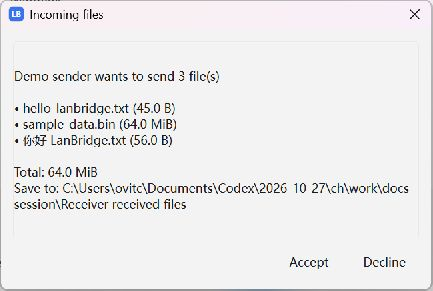

The **Incoming files** dialog contains:

- The sender's saved identity name.
- All offered file names and sizes; scroll if needed.
- The total transfer size.
- **Save to**, the destination configured on this receiver.
- **Accept** and **Decline** buttons along the bottom.

Click **Accept** to begin. Files then save automatically; you do not browse for
the sender's files or choose a destination on every request. The pictured folder
is a demo folder. New installations default to **Desktop/LanBridge Received**; existing saved paths stay in use.

Click **Decline**, or close the request dialog, to refuse. No file content should
be sent and no partial destination file should be left. Ignoring the request
also ends it when its 90-second decision deadline expires.

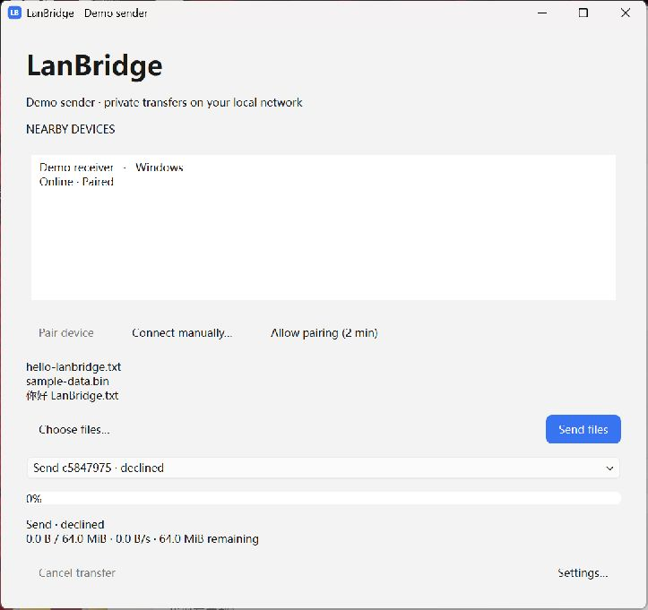

A hidden main window does not stop the receiver when its tray/menu-bar app is
still running. If the entire app was quit or the computer is asleep/offline, it
cannot show a new request. If an expected dialog is not visible, bring LanBridge
forward from its tray/menu bar and check that it is the paired installation.

## 6. Understand progress, completion and cancellation

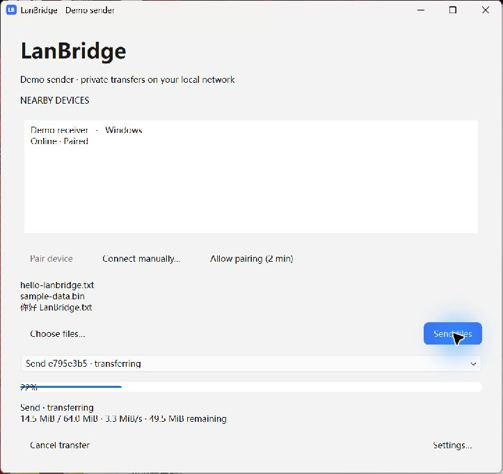

The lower part of the main window shows the selected task:

| State / field | Meaning / next action |
| --- | --- |
| **connecting** | Opening an authenticated encrypted connection. |
| **waiting for acceptance** | The receiver has not accepted yet; wait for its decision. |
| **transferring** | File bytes are being streamed. |
| Transferred / total, speed, remaining | Current byte progress, estimated transfer rate, and bytes still to send. |
| **verifying** | Bytes have been sent; the sender is waiting for final receiver validation. |
| **complete** | Receiver validation and completion confirmation succeeded. |
| **declined** | The recipient refused the request. |
| **cancelled** / **error: …** | The transfer did not complete successfully; inspect the reason before retrying. |

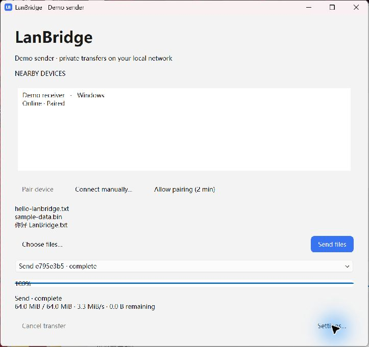

**To cancel:** select the intended task in **Transfer history**, then click
**Cancel transfer** at the lower left. This matters if more than one task appears.
The sender can cancel while waiting; a receiver still at the consent dialog
uses **Decline**. During active reception it can select the receiving task and cancel.

The other side may report cancellation as a disconnect/error. It must not report
success. Interrupted transfers restart from the beginning; V1 has no resume.

The dropdown is a recent **current-session** task view. It is not a persistent
sent/received database and is not restored as a full history after restarting.

Failed, cancelled and declined tasks show their terminal label instead of a
stuck percentage. **Archive task** closes the current result and returns to
Ready; select its **Archived** entry in Transfer history to review it again.
Archiving keeps files and does not cancel a running task. These history entries
are held for the current app session and are cleared when the app quits.

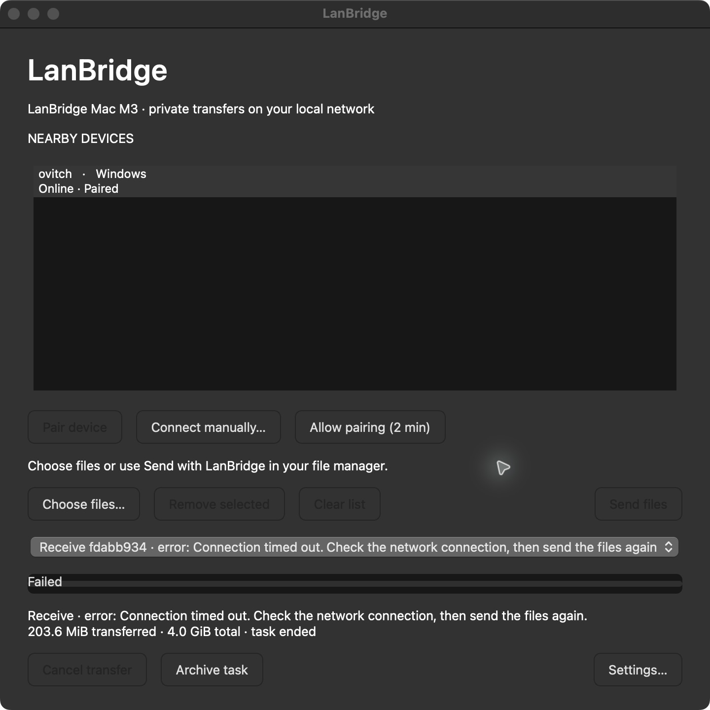

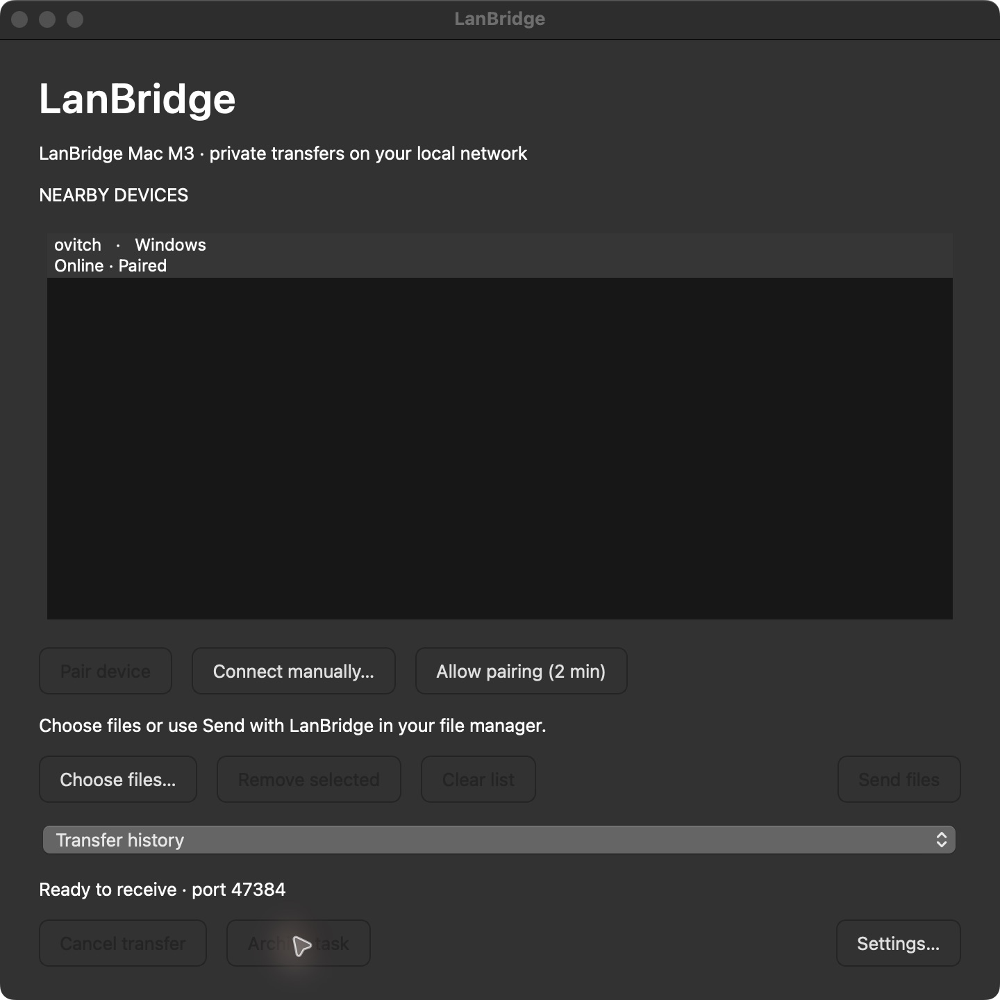

## 7. Find files and understand duplicate names

New installations receive into **Desktop/LanBridge Received**. Existing saved destinations, including Downloads, stay in use. Change the folder with **Settings… → Save received files to → Browse… → Save**. In the folder picker you can create a folder, or enter a new absolute path in the settings field and click **Save** to create it. Both computers set their own receive folder; choosing a send file does not change it.

On Mac, **Browse… → Desktop → New Folder → Create → Open**, then **Save** in LanBridge. This exact flow was exercised on the real M3.

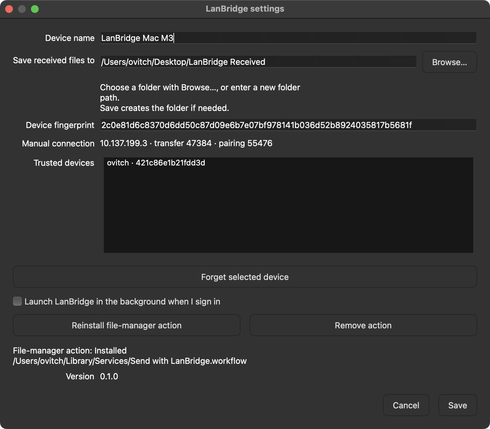

To open it, use the tray/menu-bar menu's **Received Files**. This opens the
directory in the system file manager; it does not execute a received file.

If `report.pdf` already exists, the new copy is saved as `report (1).pdf`, then
`report (2).pdf`, and so on. The same rule applies to identical basenames in a
multi-file request. Existing files are not silently replaced.

Normal cancellation/disconnection removes incomplete staging. Restarting the
receiver cleans its matching marked staging directories in the configured folder.
If a crash happens after some validated files have been published, complete files
may remain. A lost final receipt can also leave complete files while the sender
reports failure. Inspect the folder before retrying to avoid extra duplicate copies.

## 8. Configure settings

Click **Settings…** at the main window's bottom right, or **Settings** in the tray menu.

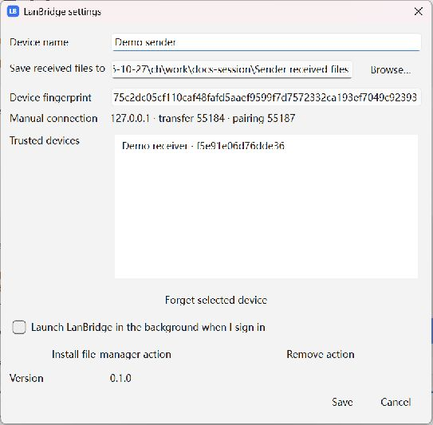

| Control | How to use it | When it takes effect |
| --- | --- | --- |
| **Device name** | Enter a recognizable local name | Save, then Quit/restart to update discovery advertising. |
| **Save received files to** / **Browse…** | Choose a writable destination folder | Save; subsequent transfers use it. Existing downloads are not moved. |
| **Device fingerprint** | Select/copy the complete certificate fingerprint | Read-only; needed for the already-paired manual fallback. |
| **Manual connection** | Read this device's addresses, transfer port and pairing port | Read-only; use the other computer's values on the sender. |
| **Trusted devices** | Select a remembered device row | Selection alone does not change trust. |
| **Forget selected device** | Remove trust for the selected row | Immediate; pending/active transfers with it are revoked. Pair again before future transfers. |
| **Launch LanBridge in the background when I sign in** | Check to enable, uncheck to disable | Save; off by default. Mac startup registration applies at the next login. |
| **Install file-manager action** | Add the current user's Explorer/Finder action | Immediate; no administrator rights required. |
| **Remove action** | Remove that native file-manager action | Immediate; received files remain. |
| **Version** | Read the app version | Informational. |
| **Save / Cancel** | Save or discard editable name/folder/startup changes | Cancel does not undo immediate Forget/Install/Remove actions. |

Forgetting a device does not delete the other computer's saved trust entry or
received files. Pair again on both sides if you want to re-establish trust.
Saved pairing names can retain an old name; a certificate fingerprint, not a
changing IP address, identifies a device.

## 9. Add “Send with LanBridge” to the file manager

The **Install file-manager action** and **Remove action** buttons are near the
bottom of the Settings screenshot above. Install separately on each computer.
Keep the app in its final location before installing the action. Settings shows **Installed / Not installed** and the action path; an installed action has a **Reinstall file-manager action** button. Reinstall updates the same shortcut/workflow, not another copy of the app. Click OK and Save to close Settings before using the file action.

Right-click sending waits briefly for discovery on a cold start. Only paired online devices are eligible; if none are available, cancel the selector and open/pair the other computer. Ordinary **Choose files…** still uses the main-window **Send files** button.

### Windows Explorer

1. Click **Settings… → Install file-manager action**.
2. Select files in Explorer.
3. Right-click → **Show more options → Send to → Send with LanBridge**.
4. Exactly one paired online target: the request starts directly. Multiple paired online targets: click one in the compact selector to send immediately. The receiver clicks **Accept**; there is no extra **Send files** step.

This uses the current user's Send To directory. Multiple selected file paths,
spaces and Unicode are supported when passed by the OS. For a very large total
command-line length, use **Choose files…** instead.

File Explorer is the normal Windows folder window; you can also right-click a file directly on the Desktop. Install the action once first. If Send to only lists built-in items such as Bluetooth and Documents, install the LanBridge action from Settings. The **Installed** path identifies the Send To shortcut, not the receive folder; **Save received files to** controls received files.

### macOS Finder

1. From the app in Applications, click **Settings… → Install file-manager action**.
2. Select files in Finder.
3. Right-click → **Quick Actions / Services → Send with LanBridge**.
4. A sole paired online target receives the request directly; with multiple targets, click the intended device in the compact selector. The receiver still clicks **Accept**.

The generated Quick Action is installed in `~/Library/Services` for the current
user. If hidden, check the OS's Services / keyboard-shortcut settings; the exact
settings path varies by macOS version.

Reinstall the action after moving the app or replacing its development environment.
Use **Remove action** to uninstall the action without deleting files or identity.
The source CLI also supports `--install-integration` and `--uninstall-integration`;
see [installation](INSTALLATION.md) if you are developing from source.

On the tested M3/macOS 15.7, **Send with LanBridge** appeared directly in the Finder context menu. Its position can vary by OS settings. Real Finder selection, normal-profile single-instance forwarding and small-file transfers to Windows passed in [M7](M7_ACCEPTANCE.md); Windows right-click direct delivery also passed a physical small-file check; the remaining edge-case checklist is still a release gate.

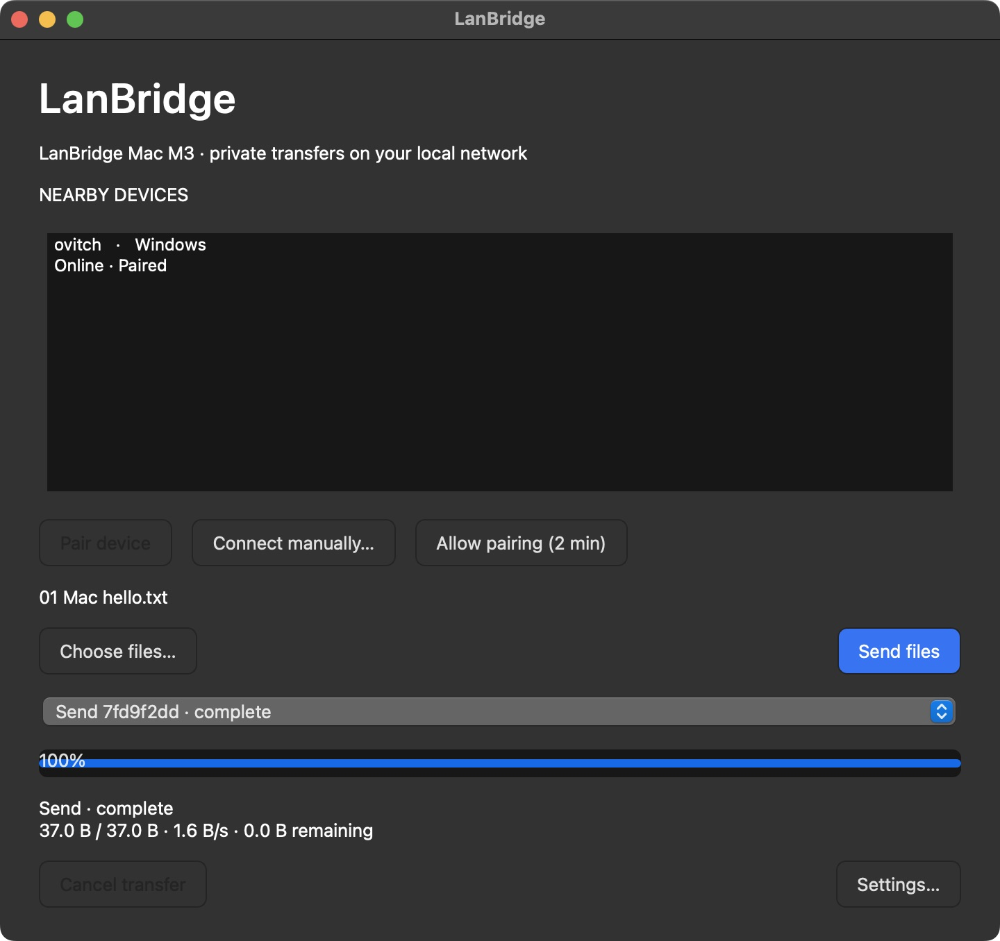

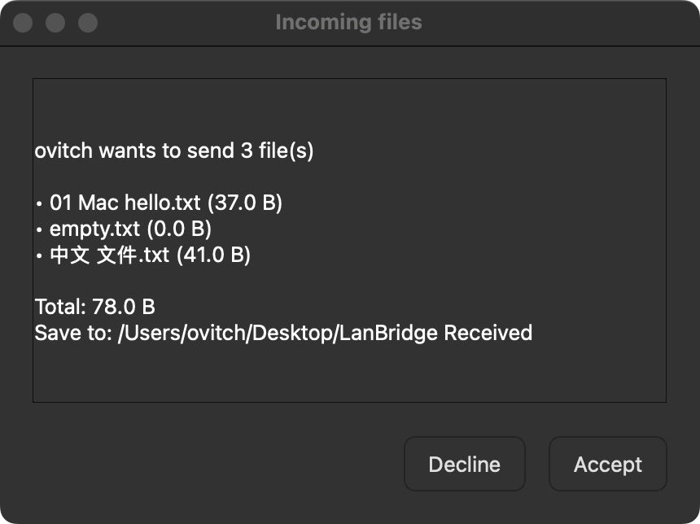

## 10. Keep receiving in the background

To return to the existing window, use **Open LanBridge** in its tray/menu bar,
or open the installed application again. Mac uses Applications/LanBridge.app;
Windows uses the extracted LanBridge.exe or its shortcut. This keeps one running
instance and preserves the previous selection. A source folder named LanBridge
is a project folder, not the installed application.

The Desktop receive-folder default, custom folder creation/selection, direct
file-manager send, editable file selection, installation status and reopening the same window apply to
both Windows and Mac. Tray/menu-bar and file-manager entry points follow each
platform's conventions.

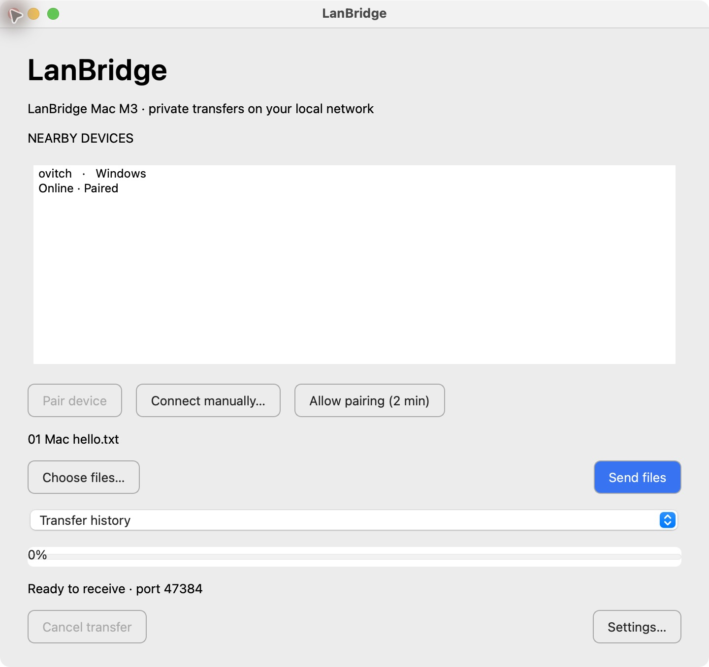

Closing the main window normally hides it while the app remains in the Windows
system tray / macOS menu bar. Keep both peers awake and connected to receive.
On a desktop with no tray support, closing the window can quit instead.

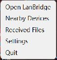

| Menu item | Action |
| --- | --- |
| **Open LanBridge** | Bring the main window back. |
| **Nearby Devices** | Bring the same device-selection window back. |
| **Received Files** | Open the configured receiving directory. |
| **Settings** | Open the settings dialog. |
| **Quit** | Stop the whole application, including its receiver. |

On Windows, an overflowed icon may be under the tray's hidden-icons arrow. On
Mac, use the menu-bar icon. Launch at login is optional and off until enabled in
Settings. **Close window and Quit are different operations.**

## 11. Use manual connection when discovery is blocked

Manual connection is a fallback. It cannot bypass a network that blocks direct
connections. Read **the recipient's Settings**, not the sender's addresses.
Pairing and transfer have **different ports**; pairing ports may change on restart.

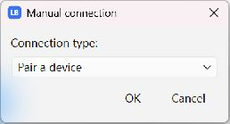

### A. A device has not been paired

1. On the receiver, click **Allow pairing (2 min)**.
2. Read its **Settings → Manual connection** address and **pairing** port.
3. On the sender, click **Connect manually… → Pair a device → OK**.
4. Enter `recipient-IPv4:pairing-port`, then click **OK**.
5. Compare all six code groups and click **Codes match on both**.
6. Select the now-paired peer and send files normally.

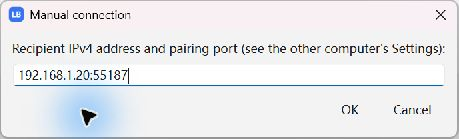

### B. The device is already paired but is not discovered

1. Read the recipient's **transfer** port and complete **Device fingerprint**.
2. On the sender choose **Connect manually… → Send to an already paired device → OK**.
3. Enter `recipient-IPv4:transfer-port` and confirm.
4. In **Paired identity**, paste the recipient's **complete 64-character fingerprint**.
   It must already be in this sender's trust store.
5. Select the added recipient and use **Choose files… → Send files**. The manual
   dialog adds the endpoint; it does not itself start a file transfer.

| Field you need | Where it comes from |
| --- | --- |
| IPv4 address | The receiving computer's Settings; use a LAN address reachable from the sender. |
| Pairing port | Recipient's **pairing** value, only for new pairing. |
| Transfer port | Recipient's **transfer** value, for an already-paired connection. |
| Device fingerprint | Complete recipient certificate fingerprint, not its display name or short list prefix. |

Do not copy the screenshot's example values. `127.0.0.1` in demo Settings is
loopback for this one-computer fixture; it cannot address a different computer.
If the receiver restarts, check the current endpoint values again.

## 12. Troubleshoot by symptom

| Symptom | What to check / do next |
| --- | --- |
| Device list empty | Both apps running and machines awake; same reachable LAN; multicast, VPN and guest/client isolation. Try manual connection. |
| **Pair device** unavailable | Select an unpaired device. It is disabled once that device is paired. |
| Pairing not available | Receiver must click **Allow pairing (2 min)** first; repeat after the window expires. |
| Only one pairing dialog was confirmed | Confirm on the other computer too, before the deadline; repeat with a fresh code if needed. |
| Pairing codes differ | Decline. Verify the target; never approve a mismatch. |
| **Send files** unavailable | Select actual files, a recipient row, and ensure that row says **Paired**. |
| Recipient has no request | Check it was not Quit, is still paired and connected; bring its window forward from the tray. |
| Sender is waiting | Receiver must Accept/Decline; an unanswered request times out after 90 seconds. |
| `verifying` or 100% | Wait for `complete`; the receiver has to validate and acknowledge. |
| Destination file not obvious | Use **Received Files** and check Settings; look for numeric collision suffixes. |
| Receiver unexpectedly quits | Reopen its installed app; incomplete temporary data is cleaned on startup and complete files remain. Retry from the start and accept the new request. If Finder shows a Run Shell Script error after force-quitting an action-launched app, dismiss it with OK before reopening. |
| Disconnect / cancel | Reconnect to the LAN, keep both apps running and check Paired, then send again and Accept the new request. Transfers restart from the beginning. Inspect the destination first if the final receipt might have been lost. |
| Unsafe filename / folder rejected | Select files, not folders; rename to a portable filename or make a ZIP yourself. |
| Permission denied / Insufficient free space | On the receiving computer, use **Settings… → Save received files to → Browse… → Save** to select a writable folder with enough free space, or free space in the current destination. Then the sender sends again and the receiver accepts the new request. **Archive task** closes the failed result; it does not retry. |
| Old device name | Quit/restart after saving a name; pairing records may keep their earlier saved name. |
| Native action missing after moving app | Reinstall it from Settings; on Mac check Services visibility. |
| Manual connection fails | Do not mix pairing and transfer ports; use the recipient's current IP and full trusted fingerprint. |
| Frozen app fails at startup | See [diagnostics](TROUBLESHOOTING.md); keep `_internal` with the Windows exe. |

The status area can show a detailed error. For a report, include version, OS,
steps, which button you clicked, and visible error text. Do not share private
keys, IPC tokens, full private state directories or personal file contents.

## 13. Understand security and current limits

- Mutual TLS with pinned device identities encrypts and authenticates file transport.
- First trust requires a human code comparison; discovery does not grant trust.
- Every transfer requires its own receiver consent; auto-accept is absent.
- SHA-256 validates received bytes before completion, with bounded streaming memory.
- Filenames are validated; existing files are not silently overwritten or executed.
- Requests are bounded to 100 files and 1 TiB total. File names must be portable
  and no more than 240 UTF-8 bytes; idle transfer I/O times out after 30 seconds.
- V1 has no folder transfer, resume, cloud relay, Bluetooth, mobile/web client or
  Apple AirDrop protocol compatibility. Task history is not a permanent archive.
- Current builds are unsigned/unnotarized development previews. Native CI and
  local loopback tests do not replace physical Mac M3 ↔ Windows 11 acceptance.

After your first small-file transfer, follow the [physical acceptance checklist](MANUAL_ACCEPTANCE.md)
in both directions before relying on the preview for important files. The full
[security design](SECURITY.md) records crash/receipt limitations and trust boundaries.

[Back to English README](../README.md) · [中文 README](../README.zh-CN.md) · [中文图文指南](USER_GUIDE.zh-CN.md)
