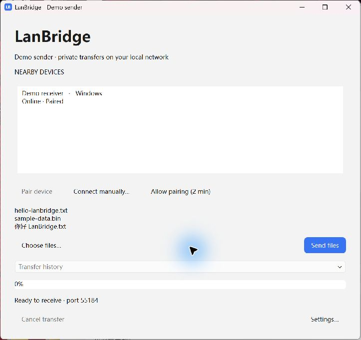

# LanBridge 中文图文操作指南

[English](USER_GUIDE.md) · **简体中文** · [返回中文 README](../README.zh-CN.md)

这份指南面向使用打包程序的普通用户。正常传文件不需要终端、Python 环境或网页。
软件界面目前为英文，下面会保留**英文按钮原名，同时解释中文意思、由哪边操作、成功后看到什么**。

**推荐顺序：** 两边安装 → 配对 → 用 **Choose files…** 发一个小文件 → 确认收到 → 再安装资源管理器 / Finder 入口。

| 直接跳转 | 内容 |
| --- | --- |
| [准备两台电脑](#preparation) | 选安装包、分清发送方和接收方 |
| [主界面](#main-window) | 每个区域和按钮的用途 |
| [配对](#pairing) | Allow pairing、Pair device、Codes match |
| [发送文件](#send-files) | 单文件、多选、选择接收设备 |
| [接收文件](#receive-files) | Accept、Decline、超时和后台弹窗 |
| [进度与取消](#progress-and-cancel) | 速度、剩余字节、任务选择和取消 |
| [文件保存](#saved-files) | 接收目录、同名文件和中断文件 |
| [设置](#settings) | 名称、目录、信任、登录启动、集成按钮 |
| [文件管理器入口](#file-manager) | Windows / Mac 右键发送 |
| [后台运行](#background) | 关窗口与 Quit 的区别 |
| [手动连接](#manual-connection) | 两种模式、两种端口和完整指纹 |
| [常见问题](#troubleshooting) | 根据现象找到下一步 |
| [安全和边界](#security-and-limits) | 已实现功能、限制和待验收内容 |

**截图说明：** 图片来自实际运行的 Windows 应用，使用本机两个隔离演示实例。
配对和文件传输使用真实网络连接，三个接收文件都与源文件的 SHA-256 一致。
为便于截图，演示传输经过限速，图中速度不是性能测试结果。设备名、验证码、指纹、
地址和路径仅为示例，不能照抄。下方 Mac 部分新增了真实 M3 截图，来自 [M7 实机验证](M7_ACCEPTANCE.md)；该记录分别列明已通过的项目与剩余验收项。

## 1. 准备两台电脑

1. 按 [README 下载说明](../README.zh-CN.md#download-and-install)取得程序。GitHub 构建产物是外层 ZIP，解压后才是实际程序包。
2. **Windows：** 完整解压便携 ZIP，打开 `LanBridge/LanBridge.exe`；保留 exe 旁的 `_internal`。
3. **Mac：** 打开 arm64 DMG，把应用复制到“应用程序”后启动。先固定应用位置，再安装 Finder 入口。
4. 两台电脑都保持唤醒、联网、运行应用。即使 Wi-Fi 名称相同，访客隔离、VPN 或设备隔离仍可能阻止互访。
5. 可在 **Settings… → Device name** 中给两边取不同的、容易识别的名字；保存后 **Quit 并重启**，更新对外广播的名称。

**发送方**是原始文件所在的电脑，**接收方**是准备保存副本的电脑。Windows 和 Mac 都能担任这两种角色。
反向测试时交换角色即可。先用没有敏感内容的小文本文件，再试多文件、中文名、空文件和大文件。

## 2. 主界面：按钮在哪里、做什么

| 界面位置 / 原文 | 怎么操作 | 含义或结果 |
| --- | --- | --- |
| 顶部名称说明 | 查看本机设备名 | 确认正在操作哪一台电脑。 |
| **NEARBY DEVICES** | 点击接收方设备行 | 显示设备名、系统和发现 / 信任状态。 |
| **Pairing required** | 先完成配对 | 只是发现了设备，尚未信任。 |
| **Paired** | 选中后可以准备发送 | 已记住对方身份，文件仍需要 Accept。 |
| **Pair device** | 发送方选中未配对设备后点击 | 开始第一次配对。 |
| **Allow pairing (2 min)** | 接收方点击 | 允许两分钟内的新配对请求，不是自动接收文件。 |
| **Connect manually…** | 自动发现不可用时点击 | 选择手动配对或连接已配对设备。 |
| **Choose files…** | 打开系统文件选择框 | 新的文件选择会替换当前选择。 |
| **Send files** | 已选文件、目标、完成配对后点击 | 发出请求，等待对方接受。 |
| **Transfer history** 下拉框 | 选择一项任务 | 决定下方显示哪项进度，以及取消哪项任务。 |
| 进度条 / 状态区 | 查看已传、总大小、速度、剩余大小 | 以 `complete` 为完成标准，不只看 100%。 |
| **Cancel transfer** | 先选任务，再点击 | 取消当前选中的活跃任务。 |
| **Settings…** | 点击右下角 | 打开名称、目录、信任和集成设置。 |

**Online 是设备发现状态，不保证稍后一定能连接。** 对方刚广播完就离线时，应显示连接错误，而不是成功。

## 3. 第一次配对：两边分别点什么

1. **接收方：** 打开 LanBridge，点击 **Allow pairing (2 min)**。
2. **发送方：** 在 **NEARBY DEVICES** 点击对方，点击 **Pair device**。
3. **两边：** 都会看到 **Verify device pairing（验证设备配对）** 窗口。

4. 对照两块屏幕，**核对全部六组验证码**，不能只看开头或结尾。
5. 完全一致才在**两台电脑上分别点击 Codes match（验证码一致）**；只点一边不会完成。
6. 任何一组不同、或不是预期的电脑，都点击 **Decline（拒绝）**。不要只凭设备名确认。
7. 回到列表，确认状态变成 **Paired**；成功配对后重启应用仍会保留信任。

配对确认的期限是 120 秒。过期或最终确认中断时，重新开放配对，再核对新的验证码。
没有固定 PIN，不能重复使用截图中的验证码。以后正常发送不用再次开放配对，
但**每次文件请求仍需接收方 Accept / Decline**。

## 4. 选择并发送文件

在**发送方**：

1. 点击 **Choose files…**。
2. 在系统选择框选文件。Windows 用 Ctrl、Mac 用 Command 多选；连续范围可用 Shift，再点“打开”。
3. 检查返回 LanBridge 后显示的名称。超过八个文件时主窗口显示前八个和总数提示；接收弹窗可检查完整列表。
4. 点击正确的 **Paired** 接收设备。
5. 点击右边的 **Send files**，等待对方决定。选择文件本身不会发送。

选错时再次 **Choose files…** 重新选择；取消系统选择框会保留原选择。V1 没有逐个移除已选文件的按钮。
**Send files 不能用时，同时检查：文件已选、设备已选、设备显示 Paired。** 蓝色外观本身不代表条件已全部满足。

不支持直接发送文件夹。需要一起传文件夹内容时，可先自行压成 ZIP 再发送；LanBridge 不会自动压缩、解压或打开 ZIP。

## 5. 接收方：接受或拒绝

**Incoming files** 会显示发送方保存的身份名、所有文件名与大小、总大小、**Save to** 保存位置。
文件多时可以滚动查看；底部有 **Accept（接受）** 和 **Decline（拒绝）**。

- 点击 **Accept** 才开始传内容，之后自动保存。接收方不用重新选择文件或每次选择目录。
- 点击 **Decline** 或关闭请求弹窗表示拒绝；不应传文件内容或留下未完成文件。
- 一直不处理，请求会在 90 秒确认期限后结束。

**图中是演示目录；新用户默认保存到桌面/LanBridge Received，已有保存路径继续生效，也可以在设置中修改。**

主窗口隐藏后，只要托盘 / 菜单栏中的应用仍在运行，仍能收到请求。整个应用 Quit、电脑睡眠或离线时无法接收。
预期弹窗没看到时，先从托盘把窗口带到前台，检查运行的是已配对的那份安装。

## 6. 看进度、确认完成、取消传输

| 状态 / 字段 | 中文意思、下一步 |
| --- | --- |
| **connecting** | 正在建立经过身份验证的加密连接。 |
| **waiting for acceptance** | 等接收方处理请求。 |
| **transferring** | 正在传文件内容。 |
| 已传 / 总大小、速度、remaining | 当前字节进度、估算速度、剩余字节。 |
| **verifying** | 内容已发送，等待接收方校验与最终回执。 |
| **complete** | 接收方校验和确认都成功，才算完成。 |
| **declined** | 对方拒绝。 |
| **cancelled / error: …** | 没有成功完成；先查看原因再重试。 |

**取消方法：** 在 **Transfer history** 中先选对应任务，再点左下角 **Cancel transfer**。
发送方可以在等待接受时取消；接收方还在请求弹窗时点 **Decline**，开始接收后再选择接收任务并取消。
对方可能将取消显示为连接断开 / 错误，但不能显示成功。中断后需要从头重传，没有断点续传。

任务下拉框只展示**当前这次运行的近期任务**，不是永久收发数据库，重启后不会恢复完整历史。

## 7. 找文件与处理重名

新用户默认接收到**桌面/LanBridge Received**；已有用户保存过的路径（包括 Downloads）继续生效。修改方式：
**Settings… → Save received files to → Browse… → 选择可写目录 → Save**。
在系统目录选择框可新建文件夹；也可直接在设置中输入新文件夹的完整路径，再点 **Save** 创建。两台电脑分别设置自己的接收目录；发送时选文件不会改变接收目录。

Mac 可按 **Browse… → Desktop → New Folder → Create → Open** 操作，回到 LanBridge 后点 **Save**。这套流程已在真实 M3 上验证。

通过托盘 / 菜单栏的 **Received Files** 可以直接打开接收目录；它只打开目录，不执行收到的文件。
已有 `report.pdf` 时，新文件会保存成 `report (1).pdf`、`report (2).pdf`；
一次请求里不同目录的同名文件也这样处理，不会静默覆盖。

正常取消 / 断线会清理未完成暂存文件；重启时会在配置目录清理属于本机身份且带标记的残留暂存目录。
若部分校验完成的文件已经保存后发生崩溃，完整文件可能留下；最终回执丢失也可能出现
“接收方已有文件，发送方却报告失败”。因此重试前先检查目录，避免额外的重名副本。

## 8. 设置窗口逐项解释

点击主窗口右下 **Settings…**，或托盘菜单的 **Settings**。

| 界面原文 | 怎么操作 | 生效方式 |
| --- | --- | --- |
| **Device name** | 填写容易识别的本机名称 | Save 后 Quit / 重启，更新广播名称。 |
| **Save received files to / Browse…** | 选择有写权限的目录 | Save 后用于后续传输，不搬动已有下载。 |
| **Device fingerprint** | 选中、复制完整证书指纹 | 只读，用于已配对设备的手动连接。 |
| **Manual connection** | 查看地址、transfer 和 pairing 端口 | 只读；发送方需要的是接收方这里的值。 |
| **Trusted devices** | 点击已保存的设备记录 | 只是选中，不改变信任。 |
| **Forget selected device** | 忘记选中的设备 | 立即撤销信任与对应待处理 / 活跃传输，未来要重新配对。 |
| **Launch LanBridge in the background when I sign in** | 勾选 / 取消登录后后台启动 | 点击 Save；默认关闭，Mac 注册在下次登录生效。 |
| **Install file-manager action** | 安装本用户的资源管理器 / Finder 入口 | 立即执行，不需管理员权限。 |
| **Remove action** | 移除文件管理器入口 | 立即执行，不删除收到的文件。 |
| **Version** | 查看版本 | 仅供查看。 |
| **Save / Cancel** | 保存 / 取消名称、目录、登录启动的编辑 | Cancel 不撤销已经执行的忘记、安装、移除。 |

忘记设备不会删除对方的信任记录或已收文件；要恢复互信需要双方重新配对。
配对记录可能保留旧名称，真正的设备身份是证书指纹，不是变化的 IP。

## 9. 从资源管理器 / Finder 发送

上图底部有 **Install file-manager action** 和 **Remove action**。
先把应用放在固定位置，再在两台电脑上分别安装入口。设置会持续显示 **Installed / Not installed（已安装 / 未安装）** 和入口路径；已安装时按钮变为 **Reinstall file-manager action（重新安装）**。重新安装只更新同一快捷方式 / workflow，不会再下载一份应用。完成后点 OK，再 Save 关闭设置。

冷启动时会短暂等待设备发现；只有已配对且在线的设备才可接收右键请求。没有可用设备时，可取消选择框，先打开对方应用或完成配对。普通 **Choose files…** 仍使用主窗口里的 **Send files**。

**Windows：**

1. 点击 **Settings… → Install file-manager action**。
2. 在资源管理器选文件，右键 → **显示更多选项 → 发送到 → Send with LanBridge**。
3. 只有一台已配对在线设备时直接发出请求；有多台时，在简洁列表点击目标即发送，无需再点 **Send files**；接收方点 **Accept**。

“资源管理器”就是平常打开文件夹的窗口，也可以直接在桌面文件上右键。首次必须先点 **Install file-manager action**；如果“发送到”只有蓝牙、文档等系统项目，说明 LanBridge 入口还未安装。**Installed 弹窗里的 C 盘路径是快捷方式的位置，不是文件接收目录**；接收目录仍由 Save received files to 决定。

入口位于当前用户的“发送到”目录。支持系统传来的多个路径、空格和 Unicode。
路径总长特别大、遇到系统命令行长度限制时，改用 **Choose files…**。

**Mac：**

1. 从“应用程序”中的应用点击 **Settings… → Install file-manager action**。
2. Finder 选文件，右键 → **快速操作 / 服务 → Send with LanBridge**。
3. 只有一台已配对在线设备时直接发出请求；有多台时点击目标即发送。对方仍需点 **Accept**。

Quick Action 放在当前用户的 `~/Library/Services`。入口隐藏时检查系统的服务 / 键盘快捷键设置，
具体路径可能随 macOS 版本不同。应用已经在后台时，文件会转交给同一实例，不需要手动启动第二个窗口。

移动应用或删除源码开发环境后，重新安装入口。**Remove action** 只移除入口，保留文件与设备身份。
开发者也可用 `--install-integration / --uninstall-integration`，见[安装说明](INSTALLATION.md)。
本轮 M3 / macOS 15.7 实测中，**Send with LanBridge** 直接出现在 Finder 右键菜单里；不同系统设置可能放在子菜单中。真实 Finder 选文件、转交正常用户配置的已有实例，以及向 Windows 传小文件已在 [M7](M7_ACCEPTANCE.md) 验证；Windows 右键直发也已完成小文件实机验证；其余边界情况仍按清单验收。

## 10. 后台运行：关窗口不等于退出

桌面接收目录默认值、自定义目录创建与选择、右键直发、安装状态提示和重开同一窗口，
均适用于 Windows 和 Mac；菜单栏 / 托盘与文件右键入口使用各自系统的形式。

要回到已有窗口，可从托盘 / 菜单栏选择 **Open LanBridge**，也可重新打开已安装程序。
Mac 使用“应用程序/LanBridge.app”，Windows 使用完整解压后的 LanBridge.exe 或其快捷方式；
这会唤回同一个实例并保留之前选中的文件。名为 LanBridge 的源码文件夹是项目目录，不是应用。

正常关闭主窗口会隐藏窗口，接收服务继续留在 Windows 托盘 / Mac 菜单栏。两台电脑仍须保持唤醒和联网。
没有托盘支持的桌面环境中，关窗口可能退出应用。

| 菜单原文 | 中文作用 |
| --- | --- |
| **Open LanBridge** | 重新显示主窗口。 |
| **Nearby Devices** | 回到同一个附近设备选择窗口。 |
| **Received Files** | 在文件管理器打开配置的接收目录。 |
| **Settings** | 打开设置。 |
| **Quit** | 彻底退出应用，同时停止接收。 |

Windows 图标可能在托盘的“显示隐藏图标”箭头中，Mac 使用菜单栏图标。
登录启动是默认关闭的可选项，需勾选并保存。
**要继续接收就关主窗口；要停止接收就选择 Quit。**

## 11. 找不到设备时手动连接

这是备用方式，不能绕过完全禁止设备直连的网络。请读**接收方的 Settings**，
不要抄成发送方自己的地址。**pairing 配对端口与 transfer 传输端口不同**，配对端口还可能在重启后改变。

**A. 尚未配对：**

1. 接收方点击 **Allow pairing (2 min)**。
2. 从接收方 **Settings → Manual connection** 读取地址和 **pairing** 端口。
3. 发送方选择 **Connect manually… → Pair a device → OK**。
4. 输入 `接收方IPv4:配对端口` 并确认。
5. 双方核对全部六组码、分别点 **Codes match**，然后回主界面正常选设备发文件。

**B. 已配对，但未自动发现：**

1. 从接收方 Settings 读取 **transfer** 端口和完整 **Device fingerprint**。
2. 发送方选择 **Connect manually… → Send to an already paired device → OK**。
3. 输入 `接收方IPv4:传输端口` 并确认。
4. 在 **Paired identity** 粘贴接收方**完整 64 字符证书指纹**，该指纹必须已经被发送方信任。
5. 在主界面选择新增设备，再 **Choose files… → Send files**。手动对话框只是添加目标，不会自动传文件。

| 需要的数据 | 从哪里取得 |
| --- | --- |
| IPv4 | 接收方 Settings，使用发送方能访问到的局域网地址。 |
| pairing | 仅用于建立新配对。 |
| transfer | 用于已配对设备传输。 |
| 完整证书指纹 | 不是设备名，也不是信任列表显示的短前缀。 |

不要照抄截图示例。演示 Settings 的 `127.0.0.1` 是本机回环地址，不能用于连接另一台电脑。
接收方重启后，请重新核对当前地址与端口。

## 12. 根据现象找到下一步

| 现象 | 检查和处理 |
| --- | --- |
| 附近设备为空 | 两边运行且唤醒、局域网可达；检查组播、VPN、访客 / 设备隔离，必要时手动连接。 |
| **Pair device** 不可用 | 先选未配对设备；已经配对时它会停用。 |
| 无法配对 | 接收方先 Allow pairing；两分钟过期重新开放。 |
| 只确认了一边验证码 | 在期限内确认另一边；超时后比较新码。 |
| 验证码不同 | 拒绝并核实目标，不能勉强批准。 |
| **Send files** 不可用 | 文件、接收设备都选中，且为 Paired。 |
| 对方没弹窗 | 确认没有 Quit、仍互信且联网；从托盘带到前台查看。 |
| 一直等接受 | 让接收方处理请求，90 秒不处理会超时。 |
| 100% / verifying | 等 complete，接收方还需校验和回执。 |
| 找不到收到的文件 | Received Files、设置目录、重名后缀。 |
| 中断 / 取消 | 从头重传；可能丢回执时先检查目标目录。 |
| 文件名 / 文件夹被拒绝 | 选普通文件、改为兼容名称，或自行压成 ZIP。 |
| 目录不可写 / 空间不足 | 更换有权限的目录并检查磁盘空间。 |
| 还是旧名字 | 保存名称后 Quit / 重启；信任记录可能保留配对时的名称。 |
| 移动程序后入口失效 | 从设置重装；Mac 还检查服务可见性。 |
| 手动连接失败 | 区分 pairing / transfer，用接收方当前 IP、完整已信任指纹。 |
| 程序不能启动 | Windows 保留 _internal，按[诊断说明](TROUBLESHOOTING.md)检查。 |

反馈时附版本、系统、操作步骤、点了哪个按钮和错误原文；不要上传私钥、IPC token、完整私有状态目录或个人文件内容。

## 13. 安全与当前功能边界

- 文件传输使用双向 TLS 和固定证书身份，兼顾加密和身份验证；自动发现不等于信任。
- 首次信任需要人工比对验证码；每次文件传输需单独接受，没有自动接受。
- 流式处理控制内存，SHA-256 校验后才确认完成；校验文件名，不静默覆盖，也不执行收到的文件。
- 单次最多 100 个文件、总大小 1 TiB；文件名须跨平台兼容且最多 240 个 UTF-8 字节，文件传输空闲 I/O 超时为 30 秒。
- 暂无文件夹传输、断点续传、云中转、蓝牙、手机 / 网页客户端或 Apple AirDrop 协议兼容；任务列表不是永久历史。
- 当前是未做发行签名 / 公证的开发预览版。CI 与本机测试不能替代 Mac M3 ↔ Windows 11 实机验收。

小文件传输成功后，请按[实机验收清单](MANUAL_ACCEPTANCE.md)做双向测试，再决定是否传重要文件。
[安全设计](SECURITY.md)记录了崩溃、回执丢失等限制和信任边界。

[返回中文 README](../README.zh-CN.md) · [English README](../README.md) · [English guide](USER_GUIDE.md)
