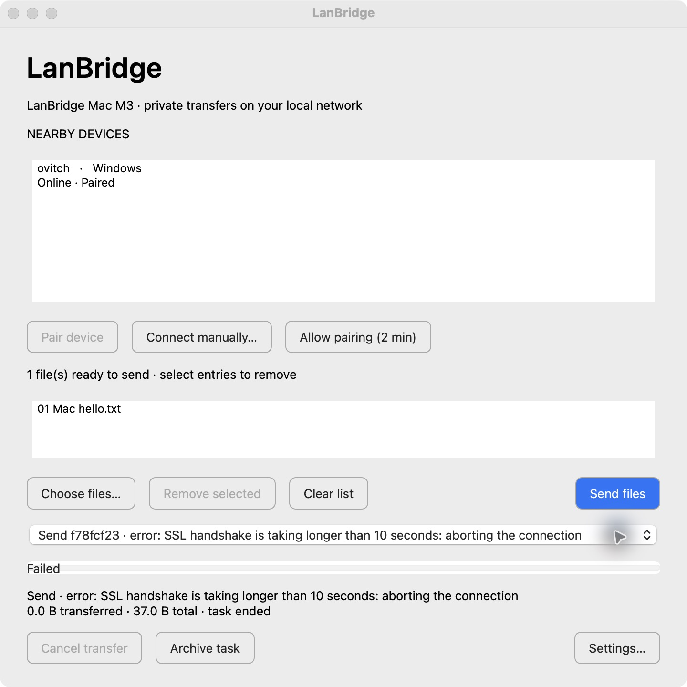
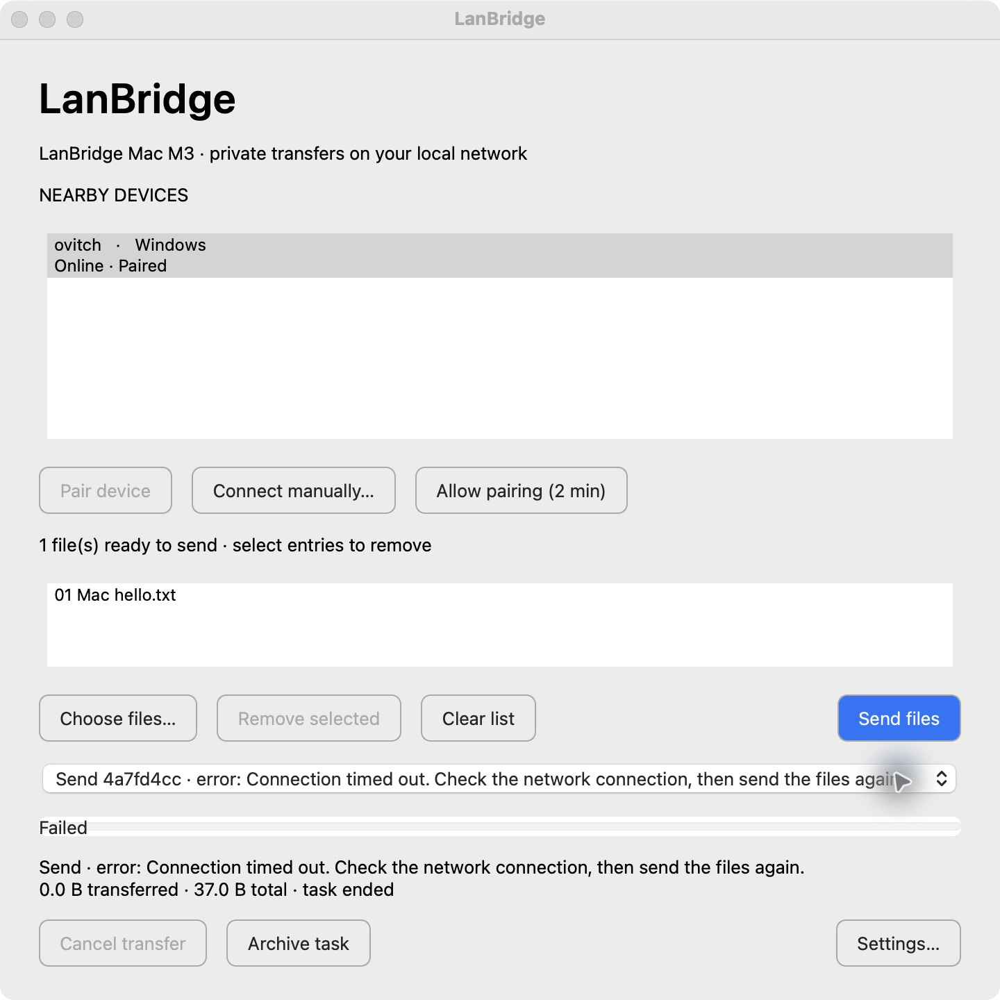

# M7 / 7A Windows 接收权限卡住：本机诊断交接

更新于 2026-10-29。**7A-1 真实双机权限拒绝、持续服务、恢复后重传及落盘哈希已通过**，
不进入 UI/UX 改版。原始现场保留，最新结果见“Windows 本机接手结果”和“Mac 接手实机复测”。
项目：`https://github.com/ovitch20051208-png/LanBridge`。
先读 [阶段规划](ROADMAP.zh-CN.md)、[实机证据](M7_ACCEPTANCE.md)、
[安全设计](SECURITY.md)、[开发流程](DEVELOPMENT.md)及本机适用的 AGENTS.md。

## 分工和代码状态

Windows 侧负责此项原生诊断/修复，Mac 侧保留发送现场并做后续跨平台回归。
交接时 Mac 没有修改传输源码。仓库已公开；同步最新 main，保护已有未提交改动。
二进制目录不是源码仓库；如没有源码，克隆到新的 `LanBridge-source` 目录。
确认根因后在 `fix/windows-staging-denied` 分支修复，每个独立模块检查后立即 commit
并推送分支；Mac 复核/回归后再合入 main，不 force-push，不重写历史。

不要重新实现已完成的传输、配对、原生入口等功能；不开始其他阶段。

## 已确认的现场

| 项目 | 证据 |
| --- | --- |
| Windows 包 | 所有者提供包内 BUILD-INFO：`ec981af75eb03f5e1df06c8afb51c8d23e640151`、`source_dirty=false`、0.1.0、AMD64、Python 3.12.10、Qt 6.12.0。 |
| Windows EXE | `C:\Users\ovitc\Desktop\LanBridge_V5\LanBridge\LanBridge.exe`。诊断前监听 PID 6940；之后所有者已从托盘 Quit 并重开，**不能继续假定 PID 还是 6940**。 |
| Windows 地址 | WLAN `10.137.199.4`，网关 `10.137.199.1`；另有若干 APIPA 网卡。Mac 是 `10.137.199.3`，测试时在同网段。地址需重新核对，不写死进产品。 |
| 测试接收目录 | `C:\Users\ovitc\Desktop\LanBridge Permission Test`，已在真实 App Settings 选中并 Save。 |
| 权限备份 | `C:\Users\ovitc\Desktop\LanBridge Permission Test.acl`，位于目录外，须保留用于恢复，不是新下载的软件。 |
| 限制方式 | 对新建空目录执行 `icacls /save` 后，以交互用户 SID `/deny *SID:(WD,AD)`；无递归/继承标记，不修改正常接收目录或桌面父目录。两条命令均报告 1 个成功、0 个失败。 |
| 实际写入探针 | `New-Item -ItemType Directory ...\write-probe` 报 UnauthorizedAccessException / CreateDirectoryUnauthorizedAccessError，证实创建子目录被拒绝。 |
| UI | 所有者报告主窗口及 Settings 仍可点击；端口所属 LanBridge 的 Responding=True。**这不能证明网络线程正常。** |
| 文件清理 | 最后一次 Accept 后，所有者执行 `Get-ChildItem -Force`，测试目录没有任何条目输出。 |

真实 Mac 发送的是生成的 `01 Mac hello.txt`，37 B，源 SHA-256：
`4877bb69a9a4b2443be1dab75950cbc958e36760b378c415b2c2f7b7d3430a1b`。
Mac 使用 `/Applications/LanBridge.app` 的干净 arm64 `ec981af` 正常用户配置，
PID 61426，接收目录仍为桌面/LanBridge Received；十个已有文件未变、无 Mac 暂存。

## 实际尝试及范围

- `5dfc0670…`：Mac 等待接受；所有者未确认接受。操作员从 Mac 取消并归档，0/37 B。
  此次不能用来判定 Windows 权限处理通过。
- `f78fcf23…`、`81b3150d…`：Mac 报 TLS handshake 超过 10 秒；Windows 无请求。
  Mac lsof 在后者看到 `10.137.199.3 → 10.137.199.4:47384 ESTABLISHED`；
  Windows 命令确认该端口属于 LanBridge，不是地址/端口未知。
- 当时独立 mDNS 查询无 Windows 回答，Mac 旧条目仍标 Online；暂不把这一现象
  单独定为发现功能的根因。Windows 日志尾部只有 10 月 27–28 日的三条旧错误。
- 所有者 Quit/重开同一包后，Mac 再次收到相同 Windows 身份的设备广播。
- `4a7fd4cc…`：重开后 TLS 成功，Mac 进入等待接受；所有者确认 Incoming files
  出现并点击 Accept，但 Windows 主窗口不变化，没有权限错误，目录仍为空。
  最后 Mac 报 Connection timed out，0/37 B。**重开没有修复此 Bug。**
- Mac 已归档失败并回到 Ready；Windows 最终是否已退出/是否仍在重试须先检查。





## 明确候选：暂存目录创建重试阻塞网络循环

`lanbridge/network/transfer.py` 在接收方 Accept 后同步调用
`tempfile.mkdtemp(..., dir=directory)`。CPython 3.12 的实现对 PermissionError 有
Windows 特例：当 `isdir(dir)` 且 `os.access(dir, W_OK)` 为真时，继续尝试新名字，
直到 TMP_MAX。查看[上游源码](https://github.com/python/cpython/blob/3.12/Lib/tempfile.py)。
若 NTFS ACL 拒绝创建，但 os.access 仍为真，大量同步重试会阻塞 asyncio 网络线程，
使 UI 仍响应而收件不回执、后续握手/发现停滞。

Mac 上的隔离行为模型复现了连续四次 PermissionError 后继续重试；模型主动终止，
没有修改文件系统。**这不是原生 NTFS 复现或实际线程栈，根因仍须 Windows 验证。**

## Windows 侧执行顺序

1. 先只读采证：源码状态、系统/架构、包版本、当前 PID/监听者、日志、接收路径、
   目录 ACL、交互用户和诊断命令的 SID。不要输出私钥、IPC token 或完整用户配置。
   若有可用的安全线程/调用栈工具，优先确认卡住位置；不要盲目安装调试驱动。
2. 使用**原生 Windows x64 Python 3.12**和隔离配置/目录建立有时限的复现。
   记录直接 mkdir 的权限错误、`os.access(W_OK)` 和 tempfile 行为；旧 tempfile 测试
   放进可限时终止的专用子进程，避免卡住 Codex/pytest/用户应用。不以 WSL 结果代替 NTFS。
3. Codex 沙盒可能使用不同用户/权限。记录真实运行身份；交互用户的拒绝 ACL
   不一定限制另一个沙盒 SID。自动化应在自己新建目录拒绝实际测试 SID，结束后恢复；
   真实 App 复测仍由当前用户运行。需要额外目录访问时按现有权限流程申请，不关闭沙盒/
   防火墙，不借用管理员绕过 ACL 后宣称通过。
4. 确认后做最小修复：创建暂存目录时权限/磁盘错误及时返回；只对真实命名冲突有限重试。
   可采用不可预测随机名的原子 mkdir，保留私有模式、现有 owner marker/前缀及清理规则。
   不用 os.access 替代真实 ACL 检查，不吞异常，不通过扩充权限让测试通过。
5. 回归必须验证：NTFS 拒绝时双方迅速 Failed/非空原因、0 内容、无暂存，网络服务继续
   能处理后续请求；命名碰撞不覆盖已有目录/文件；正常成功、Decline、取消、重启清理仍通过。
6. 运行相关检查及 `python scripts/check.py`；修复 commit/推送分支后报告准确 SHA、CI、
   原生包自检和实机结果，安排 Mac 回归及真实双机接受后的权限拒绝测试，再合入 main。
   全量已有测试通过不能替代这次失败场景。

## 恢复现场

先完成必要采证。需要结束挂住应用时只操作这一个 LanBridge 测试进程，记录退出方式；
不要结束其他进程。权限备份可恢复唯一测试目录：

```powershell
icacls.exe 'C:\Users\ovitc\Desktop' /restore 'C:\Users\ovitc\Desktop\LanBridge Permission Test.acl'
```

本次标准非管理员诊断令牌在**新建隔离目录**上执行 `icacls /restore` 返回 1300
（Not all privileges or groups referenced are assigned to the caller），连未修改 ACL 的
备份恢复也会如此；不要因此提权或扩大权限。可仅从已保存备份恢复该唯一目录的 DACL：

```powershell
$permissionTestPath = 'C:\Users\ovitc\Desktop\LanBridge Permission Test'
$permissionAclBackup = 'C:\Users\ovitc\Desktop\LanBridge Permission Test.acl'
$savedAclLines = @(Get-Content -LiteralPath $permissionAclBackup -Encoding Unicode |
    Where-Object { $_.Trim() })
if ($savedAclLines.Count -ne 2 -or
    [string]$savedAclLines[0] -ne (Split-Path -Leaf $permissionTestPath)) {
    throw '备份不只包含预期测试目录；停止恢复'
}
$accessSection = [System.Security.AccessControl.AccessControlSections]::Access
$restoredAcl = Get-Acl -LiteralPath $permissionTestPath
$restoredAcl.SetSecurityDescriptorSddlForm([string]$savedAclLines[1], $accessSection)
Set-Acl -LiteralPath $permissionTestPath -AclObject $restoredAcl -ErrorAction Stop
$expectedAcl = New-Object System.Security.AccessControl.DirectorySecurity
$expectedAcl.SetSecurityDescriptorSddlForm([string]$savedAclLines[1], $accessSection)
$actualAcl = Get-Acl -LiteralPath $permissionTestPath
# Windows 可重新标注 AI/AR 元数据；比较每条 ACE 和继承保护状态。
$actualRules = [regex]::Replace(
    $actualAcl.GetSecurityDescriptorSddlForm($accessSection), '^D:[^(]*', 'D:')
$expectedRules = [regex]::Replace(
    $expectedAcl.GetSecurityDescriptorSddlForm($accessSection), '^D:[^(]*', 'D:')
if ($actualRules -ne $expectedRules -or
    $actualAcl.AreAccessRulesProtected -ne $expectedAcl.AreAccessRulesProtected) {
    throw '恢复后的 DACL 与备份不一致'
}
```

此替代步骤已在新建隔离目录以同一非管理员令牌验证，并将真实备份仅应用到仓库内新建
探针目录：恢复后的每条访问规则和继承保护状态均与备份一致，真实创建子目录成功。
它不改变所有者或 SACL，不扩充原有权限。运行后仍须完成下面的写入
探针、Settings 恢复和真实重传；不能仅凭 ACL 命令成功签字。

确认输出仅恢复测试目录、写入探针恢复成功，再在真实 App Settings 选回原来的桌面
`LanBridge Received`，Save。检查有无迟到的暂存并按应用正常清理路径处理。
保留 `.acl` 到恢复确认；不自动删除用户文件。只有恢复后真实重传、落盘哈希和双方
complete 均确认，才能签字完成 7A-1；7A 空间/强制结束、7B–7E 仍是后续工作。

## Windows 本机接手结果 — 2026-10-29

### 根因和修复

- 从干净的已跟踪源码 `e714f2f` 安全同步 main，在 `fix/windows-staging-denied` 工作。
  原有未跟踪 `LanBridge.exe`、`_internal/` 未移动、覆盖或提交；无适用 AGENTS.md。
- 本机 Windows 11 x64（10.0.26200）、C: NTFS，原生 AMD64 Python **3.12.10**；
  诊断进程是交互用户，SID 与现场拒绝 ACL 一致，使用标准非管理员令牌。
- 首次采证看到旧包 PID 2768、端口 47384、Responding=True、累计 CPU 约 17,923 秒，
  当前 Settings 仍指向权限测试目录，日志只有交接中的三条旧记录。没有获得该旧进程的
  线程栈；后面的栈来自全新隔离身份/目录运行的真实接收服务，不能混称。
- 新建隔离目录只拒绝实际测试 SID 的 `(WD,AD)`，没有继承/递归标记。真实 `mkdir`
  返回 `PermissionError` / errno 13 / WinError 5，**`os.access(W_OK)` 仍为 True**。
  原版 `tempfile.mkdtemp` 2 秒内超过 10,000 次真实 mkdir 尝试，专用子进程到时被终止；
  faulthandler 栈停在本机 `tempfile.py` 的 `mkdtemp`，目录保持空，随后恢复并验证可写。
- 修复前新增的真实 TLS 接收回归在 12 秒硬上限被终止；4 秒栈明确为
  `TransferServer._handle → tempfile.mkdtemp`，证明它阻塞了 asyncio 线程，连该线程内的
  2 秒超时也不能执行。这是原生 NTFS 和实际服务路径证据，不是模拟 PermissionError。
- 修复提交 **`671a79ed81a6705655bab2073ebf46c6a1b8517b`** 已立即推送。
  用 128 位不可预测随机后缀和原子 `mkdir(mode=0o700)` 替换接收暂存的 `mkdtemp`；
  只对 `FileExistsError` 最多尝试 10 次，权限、空间等错误立即交给原有失败回执处理。
  暂存前缀、owner marker、清理、逐次确认、TLS、双方证书固定/配对逻辑保持原有机制。

### 已验证的范围

- 修复后的原生 ACL / TLS 子进程测试：同一个服务连续两次 Accept 后都在 0.02 秒内
  向双方报告非空 WinError 5、0 B，没有暂存或内容。恢复权限后不重启、不重新配对，
  第三个新请求再次确认并 complete；既有同名哨兵不变，新增 `(1)` 与源 SHA-256 一致。
- 新增碰撞测试保留已有目录/文件、验证重名重试有上限；权限/ENOSPC 不重试。
  全量 `python scripts/check.py`：文档、lint、format，**88 passed, 1 macOS-only skip**。
  原有成功、Decline、取消、校验失败、断线、重启清理、信任撤销等测试均在全量内。
  双独立进程演示 complete / declined 及真实 mDNS 冒烟也通过。
- 从该 SHA 的独立干净工作树构建，包内 **source_dirty=false**、AMD64、Python 3.12.10、
  Qt 6.12.0。`scripts/smoke_bundle.py` 在源码目录外运行冻结 EXE，Qt 对话框及真实 TLS
  传输 complete。最初原工作区构建因原有未跟踪二进制标为 dirty，未用作验收包。
- 本地干净 ZIP：`dist/LanBridge-windows-x86_64-671a79e.zip`；SHA-256：
  `ec89e7c34166d82b2f44d45f4491c423b3bab243391d2513a7239c0f16d12fb6`。
  这是未签名开发包，不是发行签字。
- 已对准确修复 SHA 手动调度现有 CI（分支 push 本身不触发），
  [运行 40907015423](https://github.com/ovitch20051208-png/LanBridge/actions/runs/40907015423)。
  **六项任务全部成功**：Windows/macOS 的 Python 3.12/3.13 测试及两个原生构建。
  已检查 3.12 日志：Windows 88 passed / 1 skip，Mac 87 passed / 2 skips（Windows
  COM 和新原生 ACL 测试）；两端冻结包均通过 Qt 对话框和 TLS complete 自检。

### 留给 Mac 的真实双机回归

Windows 现在运行干净修复包
`C:\Users\ovitc\Desktop\LanBridge\artifacts\windows-build-671a79e\dist\LanBridge\LanBridge.exe`，
启动后 PID 14644，UI 为 Ready、47384，并显示原 Mac Online / Paired。
PID 会变化，测试前仍须复核。诊断期间 2768 已不在；重开后旧包曾为 PID 27120、Ready，
切换修复包时仅通过 Stop-Process 结束这个已核对完整路径的空闲旧测试进程，未终止其他进程。
原配置/配对未修改，登录启动仍为关闭。**专用目录的拒绝 ACL 故意保留，外置备份保留，
目录仍为空，供下一次真实测试；尚未恢复正常接收设置。**

1. Mac 安全 fetch 并切到 `origin/fix/windows-staging-denied`；只 pull main 不包含修复。
   先确认工作区和准确 SHA。记录两端实际包版本，源码同步本身不等于正在运行新包。
2. 使用生成的 37 B `01 Mac hello.txt`，Mac 发起，Windows 核对请求和测试目录再点 Accept。
   双方应迅速 Failed / 明确权限错误、0 B；Windows 无最终文件、无暂存，既有文件不变。
   不退出或重配，再发起一个新请求并 Accept，验证后续 TLS 和收件服务仍可用。
3. Windows 恢复该目录备份 ACL，真实写入探针成功，核对目录无迟到暂存。再通过真实
   Settings / Save 选回正常桌面 `LanBridge Received`；保留备份至所有恢复检查完成。
4. Mac 再发同一源文件，Windows 再次 Accept。双方 complete，落盘 SHA-256 必须等于
   `4877bb69a9a4b2443be1dab75950cbc958e36760b378c415b2c2f7b7d3430a1b`，且无暂存。
   核对源文件、既有文件和信任未变；补做受影响的双向正常传输/Decline/取消回归。
5. 记录任务 ID、两端版本、双方状态和清理/哈希证据后，由 Mac 复核再合入 main。
   **目前不声称 7A-1 已通过，未合并 main，也未开始空间/强制结束、7B–7E 或 UI/UX。**

## Mac 接手实机复测 — 2026-10-29

Mac 拉取 `30fb3bf`，原生全量 87 passed / 2 Windows-only skips；构建干净 arm64
应用并通过严格深度临时签名及冻结程序 Qt/TLS/哈希自检后安装到 Applications。
新 PID 66956，原配置/身份/信任哈希和十个已有接收文件不变。
Windows 所有者确认运行 `671a79e` 修复包，拒绝 ACL 仍生效。

`7db6bd1d…`、`674b5d6c…` 两个真实 37 B 请求均被 Accept；Windows 所有者报告
立即拒绝访问，Mac 均收到明确 WinError 5、0 B。第二次请求证明失败后服务继续可用。
所有者确认隐藏项列表为空；Mac 已归档回到 Ready，源哈希不变。
两次错误回执与清理部分通过，完整 7A-1 仍待权限/设置恢复后的成功重传和回归。
当前请求 Windows 侧仅做 DACL 恢复/写入探针，不改源码、不做 Git 操作、不重启应用；
然后由所有者通过真实 Settings / Save 恢复正常接收目录。

## 权限恢复与 Finder 重传通过 — 2026-10-29

Windows 侧报告已按备份恢复唯一测试目录：三条 ACE、继承保护 False 均匹配；探针
创建/写入/读回/移除成功，备份哈希不变且保留，两处目录无暂存。真实 Settings / Save
选回 `C:\Users\ovitc\Desktop\LanBridge Received`。PID 仍为 14644，没有重启。
Mac PID 66956 通过实际 Finder 右键直发 `4f94568e…`，Windows Accept 后双方 complete。
Windows PowerShell 独立核对新文件 `01 Mac hello (4).txt`，37 B 原件哈希完全一致，
无暂存；Mac 原文件、身份/信任/设置不变，已归档回到 Ready。
7A-1 权限与恢复闭环通过；合并前继续受影响的反向、Decline、取消回归，不开始其他阶段。
